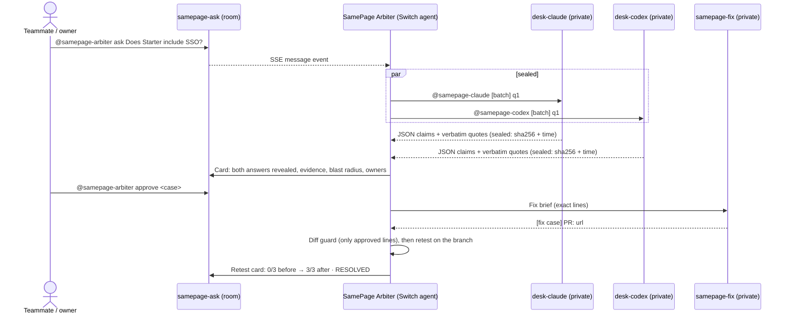

# SamePage

**SamePage turns disagreements between AI agents into an investigation, a human decision, and a verified fix.**

Companies keep the same product facts in many places: the spec, the website, the help center, the sales FAQ, support macros. Those copies drift apart. AI agents answering from them give inconsistent answers, and nobody notices until a customer does. SamePage asks **two different agents** the same question **without letting them see each other's answer**. When they disagree, or agree while the docs don't, it shows the evidence, asks the owners to rule, opens a pull request, and proves the fix with a retest.

Built for Flip the Switch (Best Business Workflow). *Juniper Desk, the company in every example, is fictional.*

> **Status (2026-11-05):** engine, arbiter, template and tests are built and pass in CI-equivalent checks. The **live run on a real Switch server has not happened yet** (`docs/RUNBOOK.md`), so live behaviour and detection metrics are unverified. See [Known limitations](#known-limitations).

## How Switch is used

Switch is the backbone, not a plugin. Without it there are no sealed rooms, no agents to compare, and nowhere for the human to rule.

| Piece | Switch feature | Where |
|---|---|---|
| **The SamePage Arbiter is itself a Switch agent** | Agent protocol: register once, SSE stream in, HTTP posts out, 2 s heartbeat | `samepage/switch_client.py`, `samepage/arbiter.py` |
| **Sealed answers** | Each worker gets a *private desk room*; Switch only lets an agent read rooms it is a member of | `switch/samepage.template.yaml`, ADR 0001 |
| **Two different agents** | Claude Code and Codex, run by Switch Console, each with the docs repo cloned through `repo:` | template `agents:` |
| **Human ruling in the chat** | Addressed messages to the arbiter (`@samepage-arbiter approve <case>`) | `samepage/decide.py` |
| **The fix** | A fixer agent with a GitHub connection, in its own private room | template, `samepage/fixer.py` |
| **One-click setup** | A Switch YAML template: 3 agents, 5 rooms, links | `switch/samepage.template.yaml` |



## What it looks like

A card from the end-to-end test (`tests/test_arbiter.py`), run against fake agents that cite real lines. Screenshots from the live run go in `docs/evidence/`.

```
#### SamePage case `9df9b224`: 🚨 CONFLICT
Question: Does the Starter plan include single sign-on?
Sealed answers (revealed together): samepage-claude: true · samepage-codex: false
Evidence: bool:false  product_spec.md L44 (authority 1) · help_center/security-and-sso.md L14-16 · support/macros.md L30-31
          bool:true   website/faq.md L20 (authority 3) · sales/faq.md L20-22
Blast radius: the disputed value appears in 2 place(s) across 2 team(s)
Proposed truth (advice, you decide): bool:false, from product_spec.md
Owners asked to rule: @marketing-lead @sales-lead
🛡 Ignored text that reads like instructions to AI agents: help_center/security-and-sso.md L29
```

## Features

- **Sealed second opinion:** two agents answer separately; the audit log proves the order.
- **Evidence or it didn't happen:** every quote is checked word for word at the cited lines; the quoted passage must be about the question, and the quote itself must state the value claimed.
- **Agreement isn't proof:** the engine scans the docs for every passage about the same fact (found by the question's and both agents' topic words), so two agents agreeing on a stale fact still raise `SOURCE_CONFLICT`. Agreement it cannot cross-check is `UNSUPPORTED`, never `VERIFIED`.
- **Blast radius:** every place the wrong fact appears, and which team reads it.
- **Owner routing:** the owners of the wrong docs are @mentioned and may approve the proposed fix (overrides and rejects need an approver).
- **Drift patrol:** `@samepage-arbiter patrol` re-asks everything known, before a customer does.
- **Source trust ledger:** `@samepage-arbiter trust` shows which docs keep losing rulings.
- **Safe fix:** a PR that changes anything beyond the approved lines is refused, and the checked commit is what gets retested; nothing is ever auto-merged.

## Quickstart

```sh
make setup      # locked deps, git hooks, .env
make check      # lint, mypy --strict, tests with coverage, bandit, pip-audit
make seed       # what the engine sees in the docs
make up         # engine API in Docker: http://localhost:8080/healthz
```

The live demo (Switch Console, Mattermost, the two agents, the docs repo) is set up step by step in **[docs/RUNBOOK.md](docs/RUNBOOK.md)**. In the room:

```
@samepage-arbiter ask <question>         @samepage-arbiter patrol [full | on <ref> | holdout]
@samepage-arbiter approve <case> [why]   @samepage-arbiter override <case> <file>
@samepage-arbiter reject <case> <why>    @samepage-arbiter trust | history <case or topic> | show <case>
```

## Outcome states

| State | Meaning | Action |
|---|---|---|
| `VERIFIED` | Agents agree, quotes verified, no doc contradicts, same wording everywhere | Answer marked verified |
| `COMPATIBLE` | Agree, docs word it differently ("24/7" vs "round-the-clock") | Treated as agreement, no alarm |
| `CONFLICT` | Agents disagree (or one found nothing) | Card + owners rule |
| `SOURCE_CONFLICT` | Agents agree, but another doc says otherwise | Card + owners rule |
| `UNSUPPORTED` | No doc covers it, a quote failed, an answer failed, or the agreement can't be cross-checked | Never shown as fact |
| `RESOLVED` | Ruled, PR open, retest passed on the fix branch | Human merges |

## Evaluation

From `reports/eval-20261106T041456Z.md` (2026-11-06 04:14 UTC, commit `0793d1a`):

| Metric | Result | Target |
|---|---|---|
| Question equivalence accuracy | 29/30 = 0.97 | ≥ 0.9 |
| Conflict detection precision / recall | not run (no recorded agent answers) | ≥ 0.90 / ≥ 0.80 |
| False alarms on COMPATIBLE | not run | 0 |
| Evidence validity | not run | 100% |

Held-out H1: not run yet. Detection numbers need a recorded live patrol (`@samepage-arbiter patrol full`, then `make eval`). They are reported only from real runs.

## Architecture

A Python service (FastAPI, Pydantic v2, SQLite in WAL mode) with no model calls of its own: the agents read, the engine verifies, normalizes, scans and classifies with plain code. See [docs/ARCHITECTURE.md](docs/ARCHITECTURE.md) and the ADRs:
[0001 Switch integration](docs/adr/0001-switch-integration.md) ·
[0002 deterministic engine](docs/adr/0002-deterministic-engine.md) ·
[0003 docs in git, batches, fixer](docs/adr/0003-docs-in-git-batch-dispatch-fixer.md) ·
[0004 patrol, blast radius, owners, trust](docs/adr/0004-patrol-blast-radius-owners-trust.md).
Plain-language tour: [docs/WALKTHROUGH.md](docs/WALKTHROUGH.md).

## Security

- **Docs are data:** lines that read like instructions to AI are excluded from facts and shown as ignored; a test proves an injected line changes no outcome.
- **Least privilege:** the engine's GitHub token is fine-grained, one repo, read-only. The fixer writes through the deployer's Switch GitHub connection. `main` is branch-protected, and SamePage has no merge call.
- **Diff guard:** a PR is refused unless it targets `main` from `samepage/<case>`, is open, changes only lines inside the approved passages (with a cap on added lines), and has no renames, mode changes, or new, deleted or binary files. The retest runs at the exact commit that was checked.
- **Authority in code:** approvers can make any ruling; owners of the losing docs can only approve the proposal. Approvers can be configured by the sender's unique id.
- **Sealing in code:** a desk reply counts only if it comes from that desk's agent and names a batch that is still open; stale, untagged or echoed messages are dropped.
- **Untrusted input:** agent replies are size-capped and schema-validated, never executed. Git refs are validated. The audit log is append-only, enforced by database triggers.
- Secrets only via `.env` (gitignored); gitleaks runs in CI and pre-commit; `bandit` and `pip-audit` report no findings.

## Known limitations

- **Not yet run live.** Switch behaviour is designed from the source at commit `7e1316f` but unconfirmed in five places (ADR 0001, U1–U5), including whether an always-on custom agent can post while streaming and whether an @mention from the arbiter wakes a Console-run agent.
- **Detection metrics not yet measured** (see Evaluation).
- **Lexical question matching:** "Does Juniper Desk support HIPAA?" maps to the support-hours question (the one miss in 30), and "Is there phone support?" scores 0.72 against support hours. A sentence-embedding backend can be plugged in (`Embedder` protocol).
- **Value types are limited** to durations, seats, rates, 24/7 schedules, yes/no and plan availability. Other values are compared as text and not cross-checked across the docs.
- **The 90-second answer target** depends on agent speed; the default timeout is 240 s.
- **Conservative by design:** answers whose value is free text, or a yes/no with no plan named, end `UNSUPPORTED` even when the agents are right, because the engine can't cross-check them.
- **The glossary and normalizer were written alongside the demo corpus.** The rules are generic, but the glossary groups cover the planted topics; a real deployment has to keep `corpus/glossary.yaml` up to date. Nothing was tuned on H1.
- **Sender check assumption:** desk replies are accepted only when Switch reports the agent's name or id as the sender. This is unverified until the live run (U5; `SAMEPAGE_STRICT_SENDER=false` relaxes it).
- Pending fix briefs are kept in memory, so restarting the arbiter mid-fix means re-approving.
- The HTTP API has no login; Docker binds it to localhost only.
- `make up` is untested here: Docker wasn't available in the build environment.
- An independent QA/Security review found 6 high and 5 medium issues; all are fixed and tested (see [docs/REVIEW.md](docs/REVIEW.md)).

## What we'd build next

Patrol on every docs push (a webhook into the room), more value types, sentence embeddings for question matching, and per-team trust trends over time.
