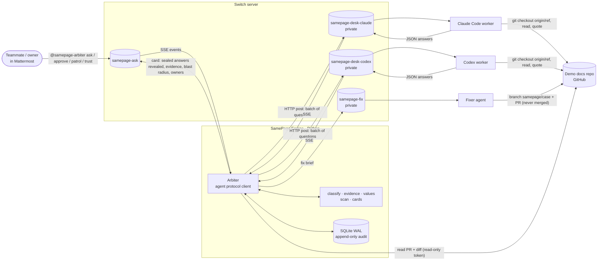

# Architecture

**Architect.** Decisions are recorded in `docs/adr/` (0001 Switch integration, 0002 deterministic engine, 0003 docs in git + batches + fixer, 0004 new features).

## The picture

## Request lifecycle (`ask`)

1. A message addressed to the arbiter arrives in `samepage-ask` as an SSE `message` event with `addressed: true`.
2. **Equivalence** maps the question onto a known canonical id, or makes a new one (`equivalence.py`).
3. **Collect** (`Arbiter.collect`): one post per desk, `@worker [batch <id>] [ref main]` + numbered questions. The arbiter waits for each worker's first reply (with a timeout), splits it into per-question answers (`parse.parse_batch`), and seals each answer (hash + time) in SQLite.
4. **Evaluate** (`classify.Engine.evaluate`): verify quotes → normalize headline values → scan the corpus for the same fact → apply the ordered rules → propose a truth (highest authority, then most sources).
5. **Card** (`cards.investigation_card`): sealed answers, why, evidence table, blast radius, proposed truth, owners to rule, ignored injection lines.
6. **Rule** (`decide.rule`): approve, override or reject, with authority checked in code. Writes the decision and the audit event.
7. **Fix** (`fixer.fix_brief`): the brief goes to the fixer; the fixer replies `[fix <id>] PR: <url>`; the arbiter checks the PR (`github.py`, `fixer.diff_problems`).
8. **Retest** (`Arbiter.retest`): the same questions on `main` and on the branch → before/after card → RESOLVED.

## Modules

| Module | Job | I/O |
|---|---|---|
| `corpus.py` | Load docs from a folder or a git ref; passages with stable line spans; tables written out per row; injection lines set aside | git (read-only) |
| `evidence.py` | Verbatim quote check, tightest span | — |
| `values.py` | Generic value normalization and plan availability | — |
| `classify.py` | Corpus scan, ordered outcome rules, proposal | — |
| `cards.py` | Card Markdown, blast radius, owners | — |
| `parse.py` | Answer Contract parsing, batch splitting, size caps | — |
| `store.py` + `migrations/` | SQLite (WAL), numbered SQL, append-only audit triggers | disk |
| `decide.py` | Rulings and authority | DB |
| `trust.py` | Trust ledger from decisions | DB |
| `equivalence.py` | Question matching behind the `Embedder` protocol | — |
| `patrol.py` | Patrol and retest reports | — |
| `fixer.py` | Fix brief, PR body, diff guard | — |
| `github.py` | Read PR metadata and diff; retries; repo pinned | GitHub API |
| `switch_client.py` | Agent protocol: SSE with reconnect + Last-Event-ID, 2 s heartbeat, posts with backoff | Switch |
| `arbiter.py` | Commands, sealed collection, workflow orchestration | Switch, DB, git |
| `api.py` | `/healthz`, `/v1/evaluate`, `/v1/trust`, `/v1/cases/{id}/history` | HTTP |
| `evaluate.py`, `golden.py` | Metrics from recorded runs; golden + held-out loading | disk |

## Data model (SQLite, `migrations/001_init.sql`)

`questions(id, text, canonical_id)`, `cases(id, canonical_question_id, question, state, ref, result_json)`, `answers(case_id, agent, raw, parsed_ok, sealed_at, sha256)` with UNIQUE(case_id, agent) so only the first answer is sealed, `decisions(case_id, decided_by, choice, truth_value, winners_json, losers_json, rationale, decided_at)`, `fix_prs(case_id PK, url, branch, status)` (one per case), `retest_runs(case_id, ref, results_json)`, and `audit_events(case_id, type, payload_json, at)`, whose triggers refuse UPDATE and DELETE.

Claims and sources are not separate tables: each case keeps its full `CaseResult` (claims, evidence, proposal) as JSON, and sources come from `corpus/sources.yaml` at the ref being read.

## Reliability rules

- External calls have timeouts and bounded retries with exponential backoff (Switch posts, GitHub reads). The SSE stream reconnects with `Last-Event-ID`, and the heartbeat runs every 2 s (per the protocol).
- Idempotency: one sealed answer per agent per case (DB constraint); one fix PR per case (`fix_prs` primary key and a check before briefing); the same `connection_id` reused across reconnects.
- Logs are JSON lines. Every handler failure is posted to the room, and no failure path reaches VERIFIED.
